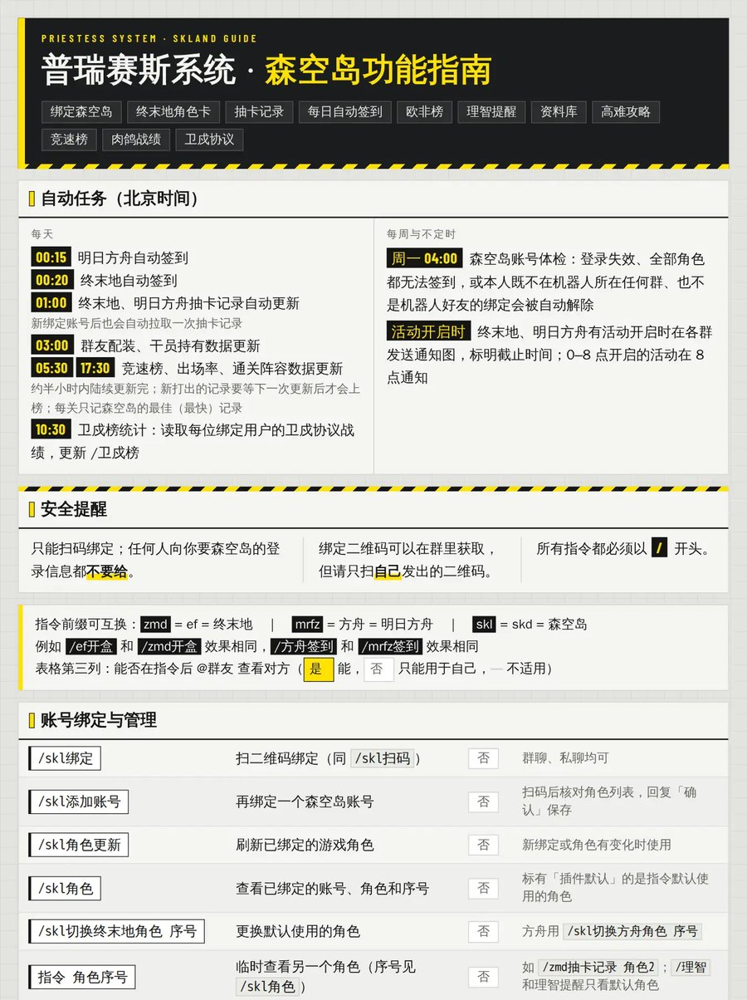
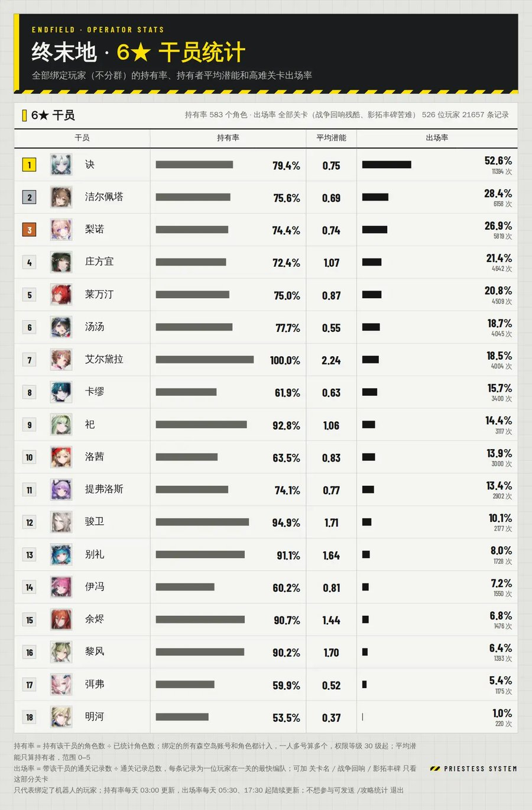
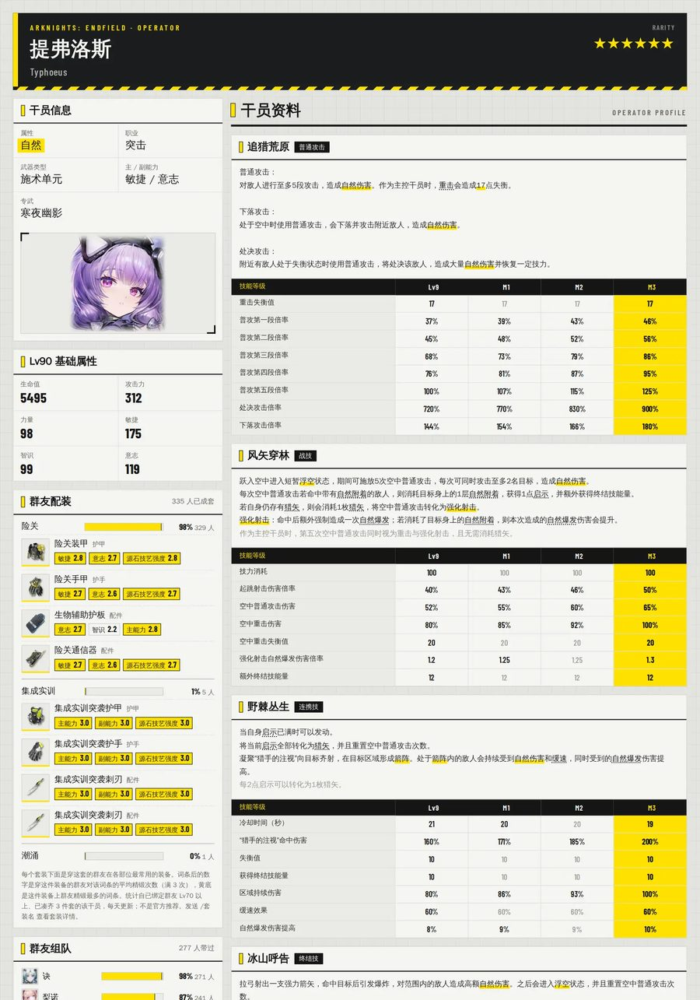

# Priestess Bot

**这个仓库不再更新了。** 最后一版是标签 `napcat-final`，之后不会再有新的提交和修复。

给《明日方舟：终末地》和《明日方舟》玩家群用的 QQ 群机器人，基于 NoneBot2，通过 NapCat 接入 QQ。

A QQ group bot for Arknights: Endfield / Arknights communities, built on NoneBot2 and connected to QQ through NapCat.
This repository is frozen and no longer maintained.


NapCat 已经停更了，官方镜像也下不到了。我把社区存档原样备份到了
[Billtranscend/NapCatQQ](https://github.com/Billtranscend/NapCatQQ/releases)，要用就从那里下，步骤见 [NapCat 部署](docs/deploy-napcat.md)。
这是第三方重新上传的，内容我没法保证，用不用你自己决定。以后 QQ 一更新，NapCat 就可能登不上或者收发不了消息。

**最后一次实测是 2026-11-20。** 我在一台 ARM64 服务器上用 NapCat v4.18.42 从零部署了一遍，空数据库，
在测试群里把帮助页上的指令挨个发了一遍，大约 70 条，测出来的问题都修好了。

测完以后我又删掉了一部分 NapCat 用不到的代码（给 QQ 官方机器人用的，在 NapCat 上从来不加载）。
删完我只确认过能装、能启动，那 70 条指令没有再发一遍。

没测到的有：明日方舟抽卡记录的年份分页、卫戍协议的对局卡片（测试账号里没有这些记录）、私聊和群临时会话、加好友、x86_64 服务器。

这次 NoneBot 是用正向 WebSocket 连的 NapCat。部署页写的是反向 WebSocket，由 NapCat 来连 `127.0.0.1:8080`。
那是我之前一直在用的方式，这次没有重新跑。

这个仓库就是一整套机器人：`bot.py` 加上 `plugins/` 下我写的本地插件。森空岛绑定、签到、角色卡这些基础功能来自上游插件
[nonebot-plugin-skland](https://github.com/FrostN0v0/nonebot-plugin-skland)，我在它上面加了终末地资料库、高难关卡资料和榜单、
两款游戏抽卡记录的自动同步、干员统计、账号体检，出的图也统一成了一种风格，另外给慢网络加了一些超时和重试。
上游的包原样安装，我的改动都在 `plugins/` 里。

## 目录

- [功能](#功能)
- [截图](#截图)
- [部署](#部署)
- [运行环境](#运行环境)
- [配置](#配置)
- [指令](#指令)
- [定时任务](#定时任务)
- [更新与重启](#更新与重启)
- [数据与隐私](#数据与隐私)
- [常见问题](#常见问题)
- [反馈](#反馈)
- [致谢](#致谢)
- [免责声明](#免责声明)
- [许可证](#许可证)

## 功能

### 账号与签到

- 森空岛账号只能扫码绑定。一个 QQ 可以绑好几个森空岛账号，默认角色随时能换，也能临时看另一个角色。
- 明日方舟和终末地每天自动签到，绑定的所有账号和角色都签。第一次绑定或新加账号时，马上签一次到、更新一次卫戍榜成绩，
  两款游戏的抽卡记录都拉完后，在绑定的地方发一条消息说结果。
- 绑定保护：二维码发在群里，也只认发指令的那个人。一个森空岛账号只能绑在一个 QQ 上，重新扫码续期也得用原来那个账号。
- 每周体检一次：登录已经失效的绑定，还有既不在机器人任何群里、也不是机器人好友的人的绑定，会被清掉，删之前先备份。

### 终末地

- 角色卡（开盒）：账号概况、据点、全部干员的练度。
- 抽卡记录：绑定后和每天自动同步，存下来就不受官方保留期限影响。赠送和免费十连单独标出来，不算抽数。
  限定寻访、辉光庆典和重构寻访都算限定池。
- 小黑盒导入：补回官方接口已经查不到的早期抽卡记录。只收和绑定 UID 一样的账号，官方记录不会被改。
- 欧非榜：所有绑定用户一起排，不分群。干员统计：所有绑定角色的 6★ 干员持有率、平均潜能和高难出场率。
- 资料库：干员、武器、装备套装和散件的资料卡。认昵称、简称和同音字，也能模糊匹配；带技能数值表、后勤技能，
  还有绑定成员的配装和组队统计（只显示汇总）。数据来自 AKEData，有新的解包数据就自动重建。
  新增干员或武器时在群里通知；重建失败或资料卡缺内容时，私聊告诉超级用户。
- 高难关卡（战争回响、影拓丰碑）：关卡一览，顺序和游戏里一样；关卡机制，算上关卡加成之后的敌人数值和抗性；群内竞速榜。

### 明日方舟

- 角色卡（开盒）：账号概况、助战、基建、全部干员的练度，用明日方舟自己的界面风格。
- 抽卡记录：绑定后和每天自动同步，存下来就不受官方保留期限影响。按卡池开放的年份分页，也可以手动马上更新。
- 小黑盒导入：补回官方接口已经查不到的早期抽卡记录。只收和绑定 UID 一样的账号，官方记录不会被改。
- 卫戍协议战绩，以及所有绑定用户一起排的奖杯榜。
- 干员一览、集成战略战绩，这两个是上游插件的。

### 通知与群功能

- 活动日历和活动开启通知（两款游戏）：有活动开了就往各群发一张图，不 @全体。0 点到 8 点之间开的，8 点统一发。
- 本周任务：两款游戏的周常放在一张图里，发 `/本周任务` 时现做。
- 理智查询；理智回满时在群里 @ 本人（`/理智提醒`）。
- 入群邀请自动同意。好友申请不自动通过。有人加好友、机器人进群，都不说话，没有欢迎语。
- 机器人被移出群或者群解散后，先看群列表里确实没有这个群了，再删掉这个群的关键词回复和发到这个群的理智提醒。
  掉线时漏掉的，每天按群列表补清一次。

### 使用约定

- 所有指令都以 `/` 开头，而且要完全对上才响应，平时聊天不会误触发。指令末尾多打的空格没关系，
  复制来的文字版「@机器人名 /指令」也照样能用。
- 榜单、统计和理智（查询和提醒）都按每个人的默认角色算，随时可以退出统计。例外有两个：
  干员统计的持有率算所有绑定的账号和角色，卫戍榜取奖杯最多的那个明日方舟角色。
- 结果有好几张图的（比如 `/zmd抽卡记录`、`/卫 全部`），会合成一张聊天记录卡片，卡片上标查询人的群名片，卡片后面 @ 他。
  `/签到详情` 的结果也是聊天记录卡片，后面同样 @ 查询人。在私聊或群临时会话里查的，结果只发给本人。
- 有些回复后面（比如 `/卫` 的战绩图后面）会跟一行「还可以发：…」，列出接下来能发的指令。群里的这种提示和文字菜单
  （比如 `/竞速榜` 的目录），提问的人发了其中一条指令，或者 90 秒没人理，就会撤回。私聊和群临时会话里不撤回。
- 图片上传超时的时候，机器人回的是「图片上传较慢…」，不是「生成失败」。图一般过一会儿还是会到，不用重发。

## 截图

| 帮助 | 干员统计 |
|---|---|
|  |  |

| 干员资料 |
|---|
|  |

## 部署

只有 NapCat 这一种接法：用一个个人 QQ 号登录 NapCat，机器人通过 OneBot v11 连它。
个人号当机器人容易被风控，NapCat 也已经停更了，这两点你要心里有数。

- 第一次部署，看 [NapCat 部署](docs/deploy-napcat.md)。
- 想改代码或者了解结构，看 [开发说明](docs/development.md)。

## 运行环境

| 项目 | 我测过的环境 | 说明 |
|---|---|---|
| 操作系统 | Ubuntu 24.04 LTS | 别的带 systemd 的 Linux 应该也行 |
| CPU 架构 | aarch64（ARM64） | 我一直跑在 Oracle Cloud Ampere A1（2 核 / 12 GB）上，最后一次实测也是 ARM64。x86_64 没测过，NapCat 要换 amd64 的镜像，见部署页 |
| Python | 3.12 | 只在 3.12 上测过，建议用同一个版本 |
| Python 依赖 | `requirements.txt` 加约束文件 `requirements.lock` | lock 里是最后一次实测时每个包的版本，装法见部署页 |
| 无头浏览器 | Playwright 1.62.0 的 Chromium | 出图用。装完 Python 依赖后要单独装一次，连同系统库，见部署页 |
| NapCat | v4.18.42（社区存档的 Docker 镜像） | 已经停更，官方镜像下不到。怎么拿、怎么校验见部署页 |
| Docker | 29.x | 只用来跑 NapCat |
| 内存 | 建议 2 GB 以上 | 出图要跑无头 Chromium |
| 中文字体 | 文泉驿正黑（`fonts-wqy-zenhei`） | 图里的中文用它，数字和英文用仓库自带的 Barlow Condensed |
| 网络 | 能访问 QQ、森空岛和鹰角网络（`skland.com`、`hypergryph.com`、`hycdn.cn`）、AKEData、PRTS Wiki、GitHub；用小黑盒导入还要能访问小黑盒 | 明日方舟数据资源从 GitHub 下载，全新部署第一次启动时的终末地卡池表也是。安装时还要能访问 PyPI 和 Playwright 的浏览器下载地址 |

Windows 和 macOS 我没测过：systemd 单元、字体的装法和一些路径都是按 Linux 写的。

## 配置

配置写在 `.env` 里：从 `.env.example` 复制一份，别提交。每一项的说明见 [NapCat 部署](docs/deploy-napcat.md#配置)。

`SUPERUSERS` 至少要填一个 QQ 号。关键词词库的管理指令只给超级用户用，没有超级用户的话，机器人一启动就报错退出。

定时任务用的是 nonebot-plugin-apscheduler 的默认时区 Asia/Shanghai，和服务器的系统时区无关。

上游 nonebot-plugin-skland 用进程的本地时间来格式化日期（苏醒日、抽卡记录日期、4 点刷新倒计时等）。
服务器不在东八区的话，给机器人进程设 `TZ=Asia/Shanghai`，示例 systemd 单元里已经写了。不设的话，
北京时间 0 点到 8 点之间的日期会早一天。

## 指令

所有指令都以 `/` 开头。「可 @他人」的意思是可以在指令后面 @ 群友，看对方的数据。
指令前缀可以互换：`zmd` = `ef` = `终末地`，`mrfz` = `方舟` = `明日方舟`，`skl` = `skd` = `森空岛`，比如 `/ef开盒` 和 `/zmd开盒` 一样。
要分几步的功能，回复里会写接下来发什么（「还可以发：…」），见 [使用约定](#使用约定)。

### 账号

| 指令 | 作用 | 备注 |
|---|---|---|
| `/skl绑定` | 扫二维码绑定森空岛（同 `/skl扫码`）。只能扫码：上游的凭据绑定（`/sk -b`、`/skland bind`）关掉了，发了也不回。手打上游的原始写法 `/sk`、`/skland`，还有依赖插件的 `/user`、`/bind`、`/argot`，都不回，所有功能都用这里列的中文指令 | 群聊、私聊都行 |
| `/skl添加账号` | 再绑一个森空岛账号 | 扫码后核对角色列表，回「确认」才保存 |
| `/skl角色更新` | 刷新已绑定的游戏角色 | |
| `/skl角色` | 看已绑定的账号、角色和序号 | 标着「插件默认」的就是指令默认用的角色 |
| `/skl切换终末地角色 序号` | 换默认角色 | 方舟用 `/skl切换方舟角色 序号` |
| `指令 角色序号` | 临时看另一个角色，不改默认角色；序号见 `/skl角色` | 比如 `/zmd抽卡记录 角色2`、`/zmd开盒 角色2`、`/卫 角色2`；写成 `-r 2` 也行 |
| `/skl解绑` | 解绑，角色和抽卡记录一起删掉 | 先选账号序号或「全部」，再回「确认」 |

### 终末地

| 指令 | 作用 | 可 @他人 |
|---|---|---|
| `/zmd开盒` | 终末地角色卡：账号概况、据点，全部干员的武器、技能等级和装备 | 是 |
| `/zmd签到`、`/zmd签到详情` | 手动签到 / 看签到状态 | 否 |
| `/签到详情` | 自己在两款游戏的签到状态，每款游戏一张聊天记录卡片 | 否 |
| `/zmd抽卡记录`、`/zmd抽卡记录更新` | 看 / 马上拉取抽卡记录。按卡池类型分图，图多时合成一张聊天记录卡片；拉完会说新增了几条 | 否 |
| `/zmd抽卡记录 限定池\|武器池\|其他卡池` | 只看一类卡池 | 否 |
| `/zmd导入小黑盒 小黑盒ID` | 从小黑盒补回更早的抽卡记录。只能导入和自己绑定的终末地 UID 一样的小黑盒账号 | 否 |
| `/干员统计 [范围]` | 6★ 干员一张表：持有率、持有者的平均潜能、高难出场率。持有率算权限等级 30 级起的所有绑定角色，一人多号算多个，干员「管理员」不算。范围可以写关卡名、`战争回响`、`影拓丰碑`，只影响出场率 | 否 |
| `/zmd欧非榜`（别名 `/欧非榜`） | 所有绑定用户的角色池、武器池欧非榜，前 10 名和后 10 名，不分群，群聊私聊都能发。按欧气排：（全服平均 − 他的平均）× √UP 数 ÷ 正常波动，至少 4 个 UP 才上榜，图上写着算法和这次用到的数字。本群成员显示群名片并标「本群」，其他人显示游戏里的角色名。发 `/zmd欧非榜 退出` 就不上榜 | 否 |
| `/角色欧非榜`、`/武器欧非榜` | 角色池 / 武器池的完整欧非榜，不分群，群聊私聊都能发。超过 300 人时只列前 150 名和后 150 名 | 否 |

### 终末地资料库

| 指令 | 作用 |
|---|---|
| `/干员名` | 干员资料卡，认昵称和同音字，比如 `/提丰`、`/小庄` |
| `/干员名专武` | 这个干员专属武器的资料卡 |
| `/武器名` | 武器资料卡，认简称 |
| `/套装名`、`/装备名` | 装备套装资料卡：3 件套效果、每件装备的属性（未精锻和精锻满级）、成员使用统计，比如 `/险关`、`/潮涌手甲`。散件按系列出卡，比如 `/涉渊护手` |
| `/干员名配装` | 和 `/干员名` 一样，干员卡里带群友的配装统计 |

### 活动日历与周常

| 指令 | 作用 |
|---|---|
| `/zmd活动`（`/终末地活动`、`/zmd日历` 等） | 终末地正在开和快要开的活动、卡池，以及截止时间 |
| `/mrfz活动`（`/明日方舟活动`、`/粥活动`、`/舟日历` 等） | 明日方舟，同上 |
| `/活动`、`/日历`、`/全部活动` | 两款游戏各发一张 |
| `/本周任务`（`/每周任务`、`/周常任务`） | 两款游戏的周常：方舟剿灭（本期轮换）、周常任务、保全派驻，终末地每周事务、通行证周常 |

游戏名和「活动 / 日历 / 活动日历 / 活动列表」中间加空格或「的」也行。时间都是北京时间。

### 高难关卡

| 指令 | 作用 |
|---|---|
| `/战争回响` | 本期轮换的关卡、封面和剩余时间 |
| `/影拓丰碑 [丰碑名]` | 所有丰碑的封面和关卡序号；带上丰碑名就显示这个丰碑每一关的封面 |
| `/敌人 领袖敌人名` | 领袖敌人的特性，以及各级（从危境挑战一级起）的默认属性；`/敌人 领袖` 是目录 |
| `/敌人 关卡名或丰碑名 [序号] [难度]` | 关卡机制和敌人属性，战争回响还带增辉条件；`/回响敌人` 看本期轮换，`/丰碑敌人` 看当前丰碑 |
| `/竞速榜` | 竞速榜目录 |
| `/竞速更新` | 马上拉自己的战争回响和影拓丰碑记录、更新榜单，每人 5 分钟一次 |
| `/回响竞速 [关卡名]` | 战争回响群内最快通关排名 |
| `/丰碑竞速 [丰碑名或关卡名]` | 影拓丰碑群内最快通关排名 |
| `/攻略统计 退出` / `加入` | 退出或重新加入组队、干员统计和榜单 |

### 明日方舟与其他

| 指令 | 作用 |
|---|---|
| `/mrfz开盒 [@用户]` | 明日方舟角色卡：账号概况、助战、基建和全部干员的练度（别名 `/mrfz卡片`、`/mrfz查询`） |
| `/卫 [@用户]`（别名 `/卫戍战绩`、`/mrfz卫戍`） | 卫戍协议战绩：奖杯、场次、Boss 击杀、完成率、游戏时长、常用策略和盟约、六维评价和称号、最近对局。后面加 `全部` 看所有对局，合成一张聊天记录卡片，再加 `第2页` 只看其中一页；加 `收藏` 看收藏的对局，`详情` 列出每一局，加数字看单局详情（比如 `/卫 3`）。数据和统计来自 nonebot-plugin-skland，图是我按明日方舟风格画的。官方数据每天 10:00 刷新 |
| `/卫戍榜` | 卫戍协议奖杯榜，赛季名取自森空岛。每天 10:30 刷新，列前 20 名，查榜的人不在里面时另外写他的名次。所有绑定用户一起排，不分群；本群成员显示群名片并标「本群」，其他人显示游戏里的名字。`/卫戍榜 更新` 只重读自己的成绩，5 分钟一次，第一次绑定和新加账号后会自动跑一次；`/卫戍榜 退出` / `加入` 决定上不上榜 |
| `/mrfz签到`、`/mrfz签到详情` | 明日方舟签到 |
| `/mrfz抽卡记录`、`/mrfz抽卡记录更新` | 看 / 马上拉取抽卡记录。按卡池开放的年份分页，一年里卡池太多时再按月分；只发最新的一页，图下面写着第几页、一共几页。拉完会说新增了几条 |
| `/mrfz抽卡记录 第N页` | 只看第 N 页（第 1 页最新） |
| `/mrfz导入小黑盒 小黑盒ID` | 从小黑盒补回更早的抽卡记录。只能导入和自己绑定的明日方舟 UID 一样的小黑盒账号 |
| `/方舟干员 [筛选词]` | 干员一览 |
| `/树海肉鸽` 等 | 集成战略战绩。另有界园、萨卡兹、萨米、水月、傀影肉鸽 |
| `/战绩详情 ID`、`/收藏战绩详情 ID` | 看单局肉鸽战绩 |
| `/理智` | 看方舟和终末地现在的理智 |
| `/理智提醒 开` / `关` | 理智回满时在本群 @ 你，要在群里开 |
| `/抽卡记录` | 列出两款游戏的抽卡记录指令 |
| `/skl帮助`（别名 `/帮助`、`/help`） | 帮助图；`/帮助 分类名` 看某一类指令的文字版，比如 `/帮助 终末地` |

### 管理指令（只有 SUPERUSERS 能用）

| 指令 | 作用 |
|---|---|
| `/森空岛体检` | 检查所有绑定，只报告，不改 |
| `/森空岛体检 清理` | 检查并解除失效的绑定，以及既不在机器人任何群里、也不是机器人好友的人的绑定；删之前先写备份 |
| `/攻略数据更新` | 马上收集高难关卡战绩 |
| `/资料库更新` | 马上重建终末地资料库 |
| `/资源更新` | 马上更新明日方舟数据资源和终末地卡池表。这是上游的指令，平时每天 09:00 自动更新 |
| `/小黑盒登录` | 私聊发：扫码登录机器人读明日方舟小黑盒数据用的那个账号。之后每天 6:10、18:10 自动续期，续不上会私聊提醒 |
| `/活动通知预览` | 预览活动开启通知图 |
| `/全体签到`、`/全体签到详情` | 马上给两款游戏的所有绑定角色签到 / 看结果 |
| `/skl全体角色更新` | 刷新所有绑定账号的角色 |
| `/卫戍榜 刷新` | 马上统计一次卫戍榜 |
| `/pe`（`/perithacus`） | 管理关键词词库（添加、删除、列出词条等），由 nonebot-plugin-pErithacus 提供；别人发一律拒绝 |

超级用户还会私聊收到这些：账号体检有改动或出错时的报告，资料库同步失败或资料卡缺内容的提醒，小黑盒登录失效或快到期的提醒。

## 定时任务

都是北京时间。

| 时间 | 任务 | 来源 |
|---|---|---|
| 每天 00:15 / 00:20 | 明日方舟 / 终末地自动签到。5 个账号同时签，几分钟就签完 | nonebot-plugin-skland、`skland_health` |
| 每天 01:00 | 终末地、明日方舟抽卡记录自动同步，新绑定的账号也会马上排进队列。终末地每次只拉新记录，每人每周完整核对一次 | `skland_auto_gacha`、`skland_ark_gacha` |
| 每天 03:00 | 收集成员的配装和持有干员，给群友配装统计和干员统计的持有率用 | `endfield_guide` |
| 每天 04:30 | 欧非榜全员重算。什么算 UP 由卡池表决定，卡池表会随游戏更新变 | `skland_gacha_rank` |
| 每天 04:50 | 按群列表补清机器人已经不在的群：删掉这些群的关键词回复和发到这些群的理智提醒 | `perithacus_guard`、`sanity_reminder` |
| 每天 05:30、17:30 | 收集高难关卡战绩（竞速榜、出场率、组队统计），榜单陆续更新 | `endfield_guide` |
| 每天 06:10、18:10 | 续期机器人读明日方舟小黑盒数据用的登录，用 `/小黑盒登录` 登过才会跑。没续上隔 10 分钟再试，每轮最多 3 次 | `heybox_import` |
| 每天 09:00 | 更新明日方舟数据资源和终末地卡池表 | nonebot-plugin-skland、`skland_ef_pools` |
| 每天 10:30 | 卫戍榜统计：用每个成员自己的森空岛登录，读他每个明日方舟角色的卫戍协议战绩，奖杯最多的角色上榜（`/卫` 还是查默认角色），5 个成员同时读。没打过的角色不上榜；一个角色都没读到的，沿用上一次的数字 | `arknights_garrison` |
| 每 10 分钟 | 检查理智有没有回满 | `sanity_reminder` |
| 每 10 分钟 | 检查 AKEData 的数据版本，有新版本马上重建；新增了干员或武器就通知各群，不管几点 | `endfield_wiki` |
| 每 10 分钟 | 资料库重建后刷新终末地卡池表，补取缺的卡池横幅 | `skland_ef_pools` |
| 每 5 分钟 | 检查两款游戏有没有活动开启，有就给所有群发通知图；0–8 点开的，8 点再发 | `game_calendar` |
| 每 30 分钟 | 检查明日方舟游戏数据的版本；PRTS Wiki 上登记的活动每小时查一次 | `game_calendar` |
| 每 6 小时 | 预先下载明日方舟干员的立绘、头像等图片 | `skland_ark_assets` |
| 每周一 04:00 | 森空岛账号体检，解绑三种：登录失效的（森空岛明确说过期才算，限流、繁忙之类下周再查）；所有角色都签不了到的（角色要隔一周再被拒一次才删）；本人既不在机器人任何群里、也不是机器人好友的。最后这种，只要有一个群的成员名单或好友列表没读全，这次就先跳过；超级用户不受影响。每删一个都先追加进备份，见 [数据与隐私](#数据与隐私) | `skland_health` |

## 更新与重启

这个仓库不会再有新版本，`git pull` 拉不到新东西了。停在标签 `napcat-final` 上就行。

**从这个仓库以前的版本换到 `napcat-final`**：先停掉机器人，备份 `data/nonebot_plugin_orm/db.sqlite3`，然后：

```bash
git fetch --tags --force
git checkout napcat-final
.venv/bin/pip install -r requirements.txt -c requirements.lock
.venv/bin/python deploy/orm_cli.py upgrade
```

以前在 `.env` 或 `.env.prod` 里配过 `QQ_BOTS`、`OFFICIAL_BRIDGE_` 开头的设置或 `HELP_MIGRATION_NOTE` 的，换过来之前删掉，这一版用不上它们，留着反而会让帮助图和体检按另一种部署来跑。

装完再启动。`requirements.lock` 是最后一次实测时每个包的版本，装的时候一直带着 `-c requirements.lock`，别单独升级里面的包。
以前照旧文档装的、没单独装过浏览器的，按 [NapCat 部署](docs/deploy-napcat.md) 第 3 步补装一次。

**重启**：只改了插件代码、依赖和数据库都没动的时候，可以用 `.venv/bin/python deploy/restart_when_idle.py` 重启。
它会等到没有指令在处理，也没有战绩收集、卫戍榜统计、账号体检或夜间签到在跑，才去重启，不会打断群友。
这个脚本认的服务名是 `nonebot.service`，而且要当前用户能免密 `sudo`。

自己改代码的话注意：仓库里没有测试（`tests/` 我没公开），也没有任何自动检查，改完要自己试。结构说明见 [开发说明](docs/development.md)。

## 数据与隐私

- `data/` 里的数据库存着用户的森空岛凭证，`.env` 和 `napcat/` 里有访问令牌和 QQ 登录状态。这几个目录和
  `compose.yaml`（可能填了 `WEBUI_TOKEN`）都已经写进 `.gitignore`。不要提交或公开，目录权限保持只有自己能读。
- 账号体检每删一个账号或角色，都先把删掉的行追加进这次的备份 `backups/skland-health/<UTC 时间>.jsonl`。
  一行是一次删除，里面有账号、角色和抽卡记录，也有登录凭证，所以目录权限是 700、文件是 600。中途出错也不会丢。
  要写回数据库，先停掉机器人，然后：

  ```bash
  # 只核对、报数，什么都不写
  .venv/bin/python deploy/restore_health_backup.py backups/skland-health/<备份文件>.jsonl data/nonebot_plugin_orm/db.sqlite3
  # 写回；有任何冲突就一行都不写
  .venv/bin/python deploy/restore_health_backup.py backups/skland-health/<备份文件>.jsonl data/nonebot_plugin_orm/db.sqlite3 --apply
  ```

  加 `--apply` 之前，先看看列出来的人该不该回来：后来自己解绑了的人，也会连同凭证一起被写回。
  写回后再启动机器人，启动时会给这些人补上默认角色。以前的 `.json` 备份也能这样用。
- 小黑盒导入只在本人发指令时，去读他的小黑盒「抽卡分析」页面，原始响应在 `data/heybox_import/` 留一份，方便以后查。
  终末地读的是公开数据。明日方舟的只对登录了的小黑盒账号开放，所以机器人要存一个专用小黑盒账号的登录状态
  （`data/heybox_import/login/`，和森空岛凭证一样别公开）。超级用户私聊发 `/小黑盒登录` 扫一次码，之后每天自动续期。
  小黑盒只有汇总数据：导入的记录里，六星（明日方舟还有五星）和它们的抽数是准的，其余的用占位记录把数量补齐。
- 竞速榜和干员统计只用绑定用户的最佳通关记录和持有干员，配装、组队和持有率只显示汇总。
  不想被统计，发 `/攻略统计 退出`、`/zmd欧非榜 退出`。
- 欧非榜不分群，别的群的人能看到上榜的人的游戏内角色名，群名片只在本群显示。不想上榜发 `/zmd欧非榜 退出`。
- 卫戍榜也不分群，不想上榜发 `/卫戍榜 退出`。
- 机器人日志不记聊天内容（`plugins/log_privacy`），但会有 QQ 号和群号，分享日志前自己打码。
- NapCat 会把收到的消息打到容器日志里，`compose.example.yaml` 已经限制了日志大小。
  systemd 日志留多久按需要设，比如 `MaxRetentionSec=30day`。

## 常见问题

**第一次启动报 `Playwright environment is not set up correctly`，起不来。** 出图用的浏览器没装好。
装完 Python 依赖后要单独装：先 `sudo .venv/bin/playwright install-deps chromium`，再 `.venv/bin/playwright install chromium`，
详见 [NapCat 部署](docs/deploy-napcat.md) 第 3 步。浏览器装在执行安装的那个用户的 `~/.cache/ms-playwright` 下，
systemd 服务要用同一个用户跑，或者安装时和服务里设同一个 `PLAYWRIGHT_BROWSERS_PATH`。

**图片发得很慢或者超时。** 从海外服务器往 QQ 传图，可能每秒只有十几到二十几 KB。大图我已经缩放和压缩过，
`API_TIMEOUT` 也调到了 180 秒，NapCat 那边的上传超时最好也调大一些。超时的时候机器人会回「图片上传较慢…」，
图一般过一会儿还是会到。

**升级了某个依赖以后起不来。** 按 `requirements.txt` 加 `-c requirements.lock` 装，别单独升级。
nonebot-plugin-skland 启动时会被校验（见 [开发说明](docs/development.md#上游插件的校验)），这是故意的：
上游代码一变，本地补丁可能悄悄失效，校验就是防这个。

**图里的中文是方块。** 装上 `fonts-wqy-zenhei` 再重启。

**活动、卡池或下期轮换没显示。** 这些来自 AKEData 的游戏解包数据，游戏更新后可能要晚一点才有，以游戏内公告为准。

**群友加机器人好友没反应。** 机器人不会自动通过好友申请，加了好友也不说话。想让群友私聊用，
就在机器人那个 QQ 号的设置里允许任何人加好友，或者手动同意。是机器人好友的人，每周体检会保留他的绑定。

**机器人退群了，Bison 的订阅还在。** Bison 自己不会在机器人退群时删订阅。我自己的机器人会自动删，但那是我服务器上单独的脚本（要 root 权限改 Bison 的数据库），没放进这个仓库。照这个仓库部署的话，退群后去 Bison 的后台删。

**NapCat 登不上，或者 QQ 更新后用不了。** NapCat 已经停更，这个仓库也不更新了，这类问题不会再有人修。

NapCat 部署本身的问题见 [NapCat 部署的常见问题](docs/deploy-napcat.md#常见问题)。

## 反馈

这个仓库已经归档，不再接受 issue 和 Pull Request。上游插件和 nonebot-bison 自己的问题，去它们各自的仓库反馈。

## 致谢

这个机器人是在下面这些开源项目和数据源的基础上做的，谢谢它们。

| 项目 | 用途 | 许可证 |
|---|---|---|
| [nonebot/nonebot2](https://github.com/nonebot/nonebot2) | 机器人框架 | MIT |
| [nonebot/adapter-onebot](https://github.com/nonebot/adapter-onebot) | OneBot v11 适配器 | MIT |
| [nonebot/adapter-qq](https://github.com/nonebot/adapter-qq) | 上游插件的间接依赖，会跟着装上，这个仓库没用到 | MIT |
| [NapNeko/NapCatQQ](https://github.com/NapNeko/NapCatQQ)、NapNeko/NapCat-Docker | QQ 协议端和它的 Docker 镜像（已停更） | 见各仓库 |
| [FrostN0v0/nonebot-plugin-skland](https://github.com/FrostN0v0/nonebot-plugin-skland) | 森空岛绑定、签到、角色卡、抽卡记录这些核心功能；`plugins/skland_ef_theme/templates/` 里的模板是从它改的 | MIT |
| [FrostN0v0/EndfieldGachaPoolTable](https://github.com/FrostN0v0/EndfieldGachaPoolTable) | 终末地卡池数据：全新部署第一次启动时用，之后由 AKEData 生成（见 `skland_ef_pools`） | 见仓库 |
| [SnowMoonSS/nonebot-plugin-pErithacus](https://github.com/SnowMoonSS/nonebot-plugin-pErithacus) | 关键词词库和回复 | MIT |
| [kexue-z/nonebot-plugin-htmlrender](https://github.com/kexue-z/nonebot-plugin-htmlrender) | 把 HTML 渲染成图片 | MIT |
| [nonebot/plugin-alconna](https://github.com/nonebot/plugin-alconna) | 指令解析和跨平台消息 | MIT |
| [nonebot/plugin-orm](https://github.com/nonebot/plugin-orm) | 数据库 ORM | MIT |
| [nonebot/plugin-apscheduler](https://github.com/nonebot/plugin-apscheduler) | 定时任务 | MIT |
| [nonebot/plugin-localstore](https://github.com/nonebot/plugin-localstore) | 本地数据目录 | MIT |
| [he0119/nonebot-plugin-user](https://github.com/he0119/nonebot-plugin-user) | 用户和平台账号绑定 | MIT |
| [KomoriDev/nonebot-plugin-argot](https://github.com/KomoriDev/nonebot-plugin-argot) | 上游插件的依赖 | MIT |
| [MountainDash/nonebot-bison](https://github.com/MountainDash/nonebot-bison) | 可以搭配的动态订阅推送，不在这个仓库里 | MIT |
| [microsoft/playwright-python](https://github.com/microsoft/playwright-python) | 无头浏览器 | Apache-2.0 |
| [encode/httpx](https://github.com/encode/httpx) | HTTP 客户端 | BSD-3-Clause |
| [python-pillow/Pillow](https://github.com/python-pillow/Pillow) | 图片处理 | MIT-CMU |
| [mozillazg/python-pinyin](https://github.com/mozillazg/python-pinyin) | 同音字检索 | MIT |
| [sqlalchemy/sqlalchemy](https://github.com/sqlalchemy/sqlalchemy) | 数据库访问 | MIT |
| [jpt/barlow](https://github.com/jpt/barlow) | Barlow Condensed 字体（`plugins/ef_theme/fonts/`） | SIL OFL 1.1 |
| [AKEData](https://www.akedata.wiki/) | 终末地解包数据：干员、武器、关卡、敌人、增辉条件、活动和卡池时间、卡池内容 | 见站点说明 |
| [小黑盒](https://www.xiaoheihe.cn/) | 终末地、明日方舟的「抽卡分析」：早期抽卡记录从这里导入 | 见站点说明 |
| [yuanyan3060/ArknightsGameResource](https://github.com/yuanyan3060/ArknightsGameResource) | 明日方舟游戏数据表：活动和卡池时间、周常任务、剿灭轮换、保全派驻 | 见仓库说明 |
| [PRTS Wiki](https://prts.wiki/) | 明日方舟已公布活动的时间、活动和卡池横幅（只用它的公开 API）、卡池 UP 干员 | CC BY-NC-SA 4.0 |

第三方代码和字体的版权声明见 [THIRD_PARTY_NOTICES.md](THIRD_PARTY_NOTICES.md)。

## 免责声明

这是我自己做的非官方工具，和鹰角网络（Hypergryph）、GRYPHLINE、森空岛、小黑盒、腾讯 QQ 都没有关系。
《明日方舟》《明日方舟：终末地》的名称、美术素材和游戏数据，著作权归各自的权利人，截图里的游戏素材只是用来展示功能。
森空岛接口不是公开接口，用这个机器人带来的账号风险由你自己承担。用个人 QQ 号挂 NapCat 可能被风控或限制登录；
社区存档的 NapCat 镜像不是官方发布的，内容我没法核实。这些风险也由你自己承担。请不要用于商业用途。

## 许可证

我自己写的代码以 [MIT License](LICENSE) 发布，第三方组件按它们各自的许可证。
